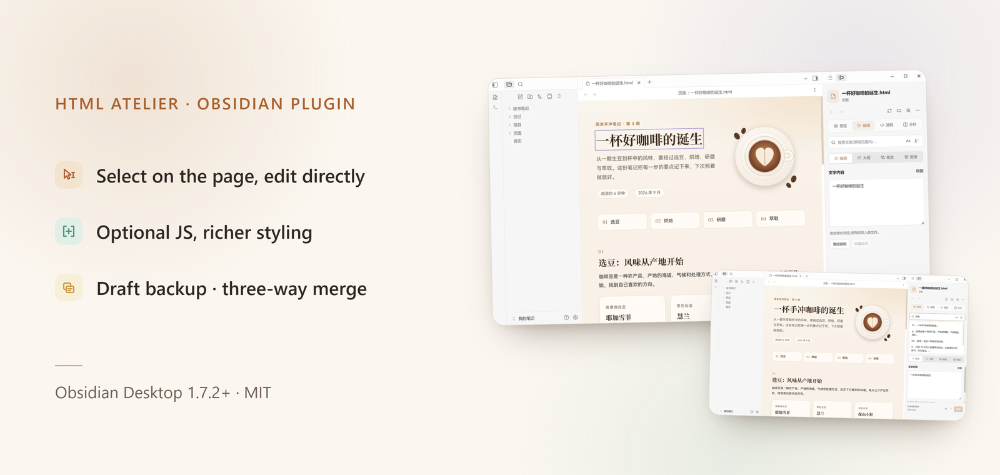
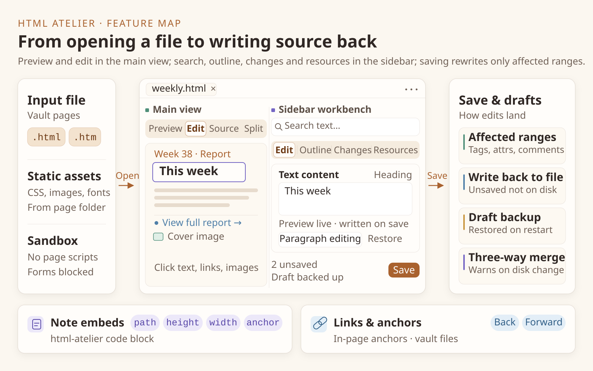
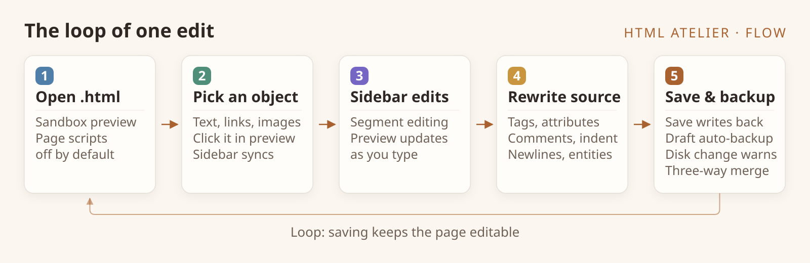

<p align="center">
  
</p>

<h1 align="center">HTML Atelier</h1>

<p align="center"><strong>Edit <code>.html</code> files directly as notes in Obsidian.</strong><br>
Select text, links or images on the page, edit them in the sidebar, and save only the part you changed.</p>

<p align="center">
  <a href="https://github.com/384615666/obsidian-html-atelier/releases"></a>
  <a href="https://obsidian.md"></a>
  <a href="#quick-start"></a>
  <a href="LICENSE"></a>
  <a href="https://github.com/384615666/obsidian-html-atelier/releases"></a>
  <a href="https://htmlatelier.lsjx.xyz/"></a>
</p>

<p align="center">
  <a href="https://htmlatelier.lsjx.xyz/"><strong>Website</strong></a> ·
  <a href="https://community.obsidian.md/plugins/html-atelier">Community plugin</a> ·
  <a href="https://github.com/384615666/obsidian-html-atelier/releases">Releases</a> ·
  <a href="https://github.com/384615666/obsidian-html-atelier/issues">Issues</a> ·
  <a href="README.md">简体中文</a>
</p>

<p align="center">
  <a href="assets/readme/hero-en.png"></a>
</p>

<p align="center"><sub>Supports .html / .htm · English and Chinese UI · local files, no account or cloud service</sub></p>

## Why HTML Atelier

-  **Select and edit in place**: pick text, a link or an image on the page, change it in the sidebar form, and watch the preview update.
-  **Optional JS, richer styling**: full CSS plus optional page scripts; scripts are off by default and can be enabled in settings, for layouts and interactions Markdown cannot express.
-  **Only the part you changed is rewritten**: untouched tags, attributes, comments, indentation, line endings and entity spellings stay exactly as they were.
-  **One workbench for the whole flow**: search, outline, changes and resources in the sidebar; drafts are backed up and conflicts can be merged.

## At a glance

<p align="center">
  
</p>

- **Main view**: Preview / Edit / Source / Split.
- **Sidebar**: a persistent search bar above the tabs plus Edit / Outline / Changes / Resources.
- **Save**: only the part you changed is rewritten; everything else stays as it was.

## What happens on every edit

<p align="center">
  
</p>

1. **Open** an `.html` or `.htm` file; the page is rendered in a sandboxed preview and page scripts do not run by default.
2. **Select** text, a link or an image; the sidebar switches to the matching form.
3. **Edit** with a live preview; unsaved work is backed up as a draft.
4. **Save**: edits are spliced back into the matching source ranges, leaving every other byte untouched.
5. If the file changes on disk while you edit, a **conflict** is reported before saving: three-way merge, adopt the disk version, or save the draft separately.

## Screenshots

<p align="center">
  <a href="assets/readme/shot-edit.png"></a>
  <a href="assets/readme/shot-split.png"></a>
  <br><sub><b>Edit</b> select a heading and change its text &nbsp;·&nbsp; <b>Split</b> source and preview side by side</sub>
</p>

<p align="center">
  <a href="assets/readme/shot-search.png"></a>
  <a href="assets/readme/shot-embed.png"></a>
  <br><sub><b>Search</b> find and replace in the draft &nbsp;·&nbsp; <b>Embed</b> scroll a note page to an anchor</sub>
</p>

<p align="center"><sub>Screenshots are from HTML Atelier 2.1.0 in a demo vault; individual settings may differ from defaults.</sub></p>

## Quick start

Requires **Obsidian Desktop 1.7.2 or later**; supports `.html` and `.htm`; mobile is not supported.

1. **Install**: open **Settings → Community plugins → Browse**, search for **HTML Atelier**, then install and enable it.
2. **Open a page**: open any `.html` or `.htm` file; the page appears in the main workspace and the sidebar workbench opens automatically.
3. **Edit**: switch to **Edit**, select an object on the page, change it in the sidebar, then click **Save**. Unsaved work is backed up automatically.

<details>
<summary><b>Manual install / another HTML plugin is enabled</b></summary>

Download `main.js`, `manifest.json` and `styles.css` from the same [GitHub release](https://github.com/384615666/obsidian-html-atelier/releases), put them in your vault's plugin folder, then restart Obsidian:

```text
.obsidian/plugins/html-atelier/
├── main.js
├── manifest.json
└── styles.css
```

Do not add an extra nested folder; substitute your custom configuration folder for `.obsidian` if needed. If another plugin already handles `.html` / `.htm`, disable it and restart Obsidian; HTML files will open in HTML Atelier again.
</details>

<details>
<summary><b>Embed a page in a note</b></summary>

Add an `html-atelier` code block to any Markdown note:

````markdown
```html-atelier
path: "Pages/weekly-report.html"
height: auto
anchor: summary
```
````

- `path` (required): path to an HTML file relative to the vault root.
- `height`: `auto` or an integer from 160 to 1600; automatic height is capped by the embed settings.
- `width`: `auto` or an integer from 240 to 3840, limited by the available note width.
- `anchor`: optional; scroll to the element's `id`, without a leading `#`.
- `toolbar`: set to `false` to hide the embed's open and refresh buttons.

Embeds read the **saved file**, not the unsaved draft; use the embed's refresh button after saving. **More → Copy HTML embed code** generates a skeleton you can extend.
</details>

## Features

### Preview & navigation

- Sandboxed preview with page scripts off by default; fixed zoom steps (25%–200%), common widths (auto / 1440 / 768 / 390 / custom) and per-file viewport memory.
- Local stylesheets (`<link>`, `@import`) are inlined; relative images resolve from the page folder. Remote assets are allowed by default and can be blocked in settings.
- In-page anchors, vault links, back/forward navigation and reading-position memory; local CSS and image changes can refresh the preview automatically.
- Preview scrollbars mimic the Obsidian style (thin rounded thumb, transparent track) and invert on dark pages; pages with their own scrollbar styling keep it.

### Visual editing

- Edit individual text segments or switch to **paragraph editing** across inline formatting; links support text, address and vault-file picking; images support address, `alt` and external import.
- Untouched source ranges keep their original tags, attributes, comments, indentation, line endings and entity spellings; special characters are escaped as text.
- Source mode offers line numbers, soft wrap and a configurable refresh delay; undo/redo merges consecutive typing.

### Sidebar workbench

- **Search bar**: find and replace within the current draft, with case matching and Replace all; matches crossing formatting boundaries are skipped and counted.
- **Edit / Outline / Changes / Resources**: edit the selected object, jump to headings and text, locate and restore text changes, inspect referenced assets.
- The footer shows the save button plus save / draft / conflict status and missing-file warnings.

### Drafts & conflicts

- Draft backup is on by default and stored per device under `.obsidian/plugins/html-atelier/drafts/`; drafts are restored when the file is reopened, including after a restart.
- When the content on disk differs from the last saved base, a conflict is reported: three-way merge (my draft / disk version / common base), use the disk version, or save the draft as a separate file.
- **More → Draft manager…** lets you search drafts, open the original or discard drafts; **Save as** can rewrite local relative references without copying assets.

### Links, anchors & sharing

- Wiki and Markdown links to HTML files open in the plugin view; in-page anchors and vault links jump inside the preview.
- The More menu copies the page link or HTML embed code, or opens the current file in your system browser; copying a section link requires a selected anchor.
- Embeds support height, width, anchor and toolbar visibility, and show the file name with refresh / open buttons by default.

<details>
<summary><b>Defaults & limits</b></summary>

- Undo history: 200 transactions by default, configurable 50–1000, within a 32 MiB memory budget.
- Drafts: snapshot after roughly 750 ms of idle typing, maximum wait about 3 seconds; storage warning at 50 MiB by default.
- Zoom: 25% / 50% / 75% / 100% / 125% / 150% / 200%; width 240–3840 px.
- Reading-position memory: the last 200 files by default, configurable 20–2000.
- Script-mode inline caps: 8 MiB per file, 4 MiB per script, 32 MiB per preview build.
- UI text follows the language setting; command-palette names, object-type labels, embed buttons and errors, and the default save-as suffix remain Chinese-only.
</details>

## Safety model

HTML files can carry scripts. HTML Atelier only **shows** pages by default; it does not execute their code.

| Scenario | Page scripts | Network assets | Visual editing / position memory |
| --- | --- | --- | --- |
| **Default preview** (recommended) | Not executed: scripts, `on*` handlers and `http-equiv` metas are removed; CSP blocks scripts, form submission and nested frames | Remote images / styles / fonts / media allowed by default; can be disabled | Available |
| **Allow page scripts** (opt-in) | Run in an `allow-scripts` sandbox **without** `allow-same-origin` (opaque origin) | Governed by the "Allow network assets" setting | Unavailable: visual editing, position memory, in-page link routing and embed auto-height are disabled |
| **Open in external browser** | Normal browser behaviour, including scripts | Not controlled by the plugin | Not applicable |

- "Allow page scripts" is off by default and should only be enabled for trusted files; static local assets are inlined as data URLs, while runtime-created resources and cross-file module imports are not.
- Script mode is **isolated, not offline**: network assets remain allowed by default, so remote scripts and requests are also permitted. Consider disabling network assets for untrusted pages.

## Scope & limits

- Visual editing covers **page text, link addresses and image attributes**; it does not edit CSS, arbitrary HTML structure, form field values or text inside SVG. Use source mode for those.
- Segment editing follows the original text nodes; paragraph editing keeps inline tags, but the distribution of changed text across formatting spans may change.
- Desktop Obsidian only; opening a page in an external browser leaves script and network behaviour to that browser.

## FAQ

<details>
<summary><b>Will visual editing reformat my HTML?</b></summary>

No. Only the affected source ranges are replaced; untouched tags, attributes, comments, indentation, line endings and entity spellings stay exactly as they were. Save-as can also keep relative references pointing at their original targets.
</details>

<details>
<summary><b>Do page scripts run?</b></summary>

Not by default. Enable **Allow page scripts** to run them in an isolated opaque-origin sandbox; visual editing and reading-position memory are unavailable in that mode, so only enable it for trusted files.
</details>

<details>
<summary><b>Can I edit CSS or page structure?</b></summary>

Visual editing does not cover layout or structure. Switch to **source mode** or split mode and edit the HTML/CSS directly; source edits still support undo, drafts and saving.
</details>

<details>
<summary><b>Where are drafts stored? Will uninstalling lose them?</b></summary>

Under `.obsidian/plugins/html-atelier/drafts/`, named per device and containing the original and edited HTML. Uninstalling the plugin or deleting its folder also deletes the backups; reopen the original file to restore the draft, then use **Save as** to keep what you need.
</details>

<details>
<summary><b>What if the file changes outside Obsidian?</b></summary>

The plugin detects the change before saving and refuses to overwrite. You can three-way merge both sides, adopt the disk version, or save the current draft as a separate file.
</details>

## How it works (for developers)

- **Parse & locate**: `parse5` parses with source locations and maps text nodes to source ranges; paragraphs that cannot be aligned prompt segment editing.
- **Surgical writes**: edits become range patches (`src/core/patch.ts`; paragraph planning in `src/parsing/paragraphEdit.ts`), and saving replaces only the affected ranges.
- **Isolated preview**: `srcdoc` + per-render nonce + sandboxed iframe + CSP; script mode switches to an opaque-origin sandbox and inlines static local assets.
- **Drafts & conflicts**: records contain the base source, working copy, checksum and device ID, written via "temp file → verify → final file"; conflicts use a diff3-based three-way merge.

<details>
<summary><b>Directory layout</b></summary>

| Directory | Responsibility |
| --- | --- |
| `src/parsing` | HTML parsing, text mapping, segment / paragraph editing, URL handling |
| `src/core` | edit sessions, history, range patches, fingerprints and locators |
| `src/views` | main view, sidebar panel, toolbar, source editor, modals |
| `src/services` | preview asset inlining, saving, drafts, merging, links, navigation, sidebar coordination |
| `src/embed` | `html-atelier` block parsing and rendering |
| `src/settings` | settings schema, UI and default-value validation |
| `src/i18n` | Chinese / English strings |
| `tests` | `node:test` + jsdom unit tests and Playwright-based browser checks |
</details>

## Development

```sh
npm ci
npm run lint
npm run check
npm test
npm run build
node tests/browser-check.mjs
node tests/sidebar-regression.mjs
```

- The build produces `main.js` (with the bundled worker); install it next to `manifest.json` and `styles.css`.
- Browser checks use Microsoft Edge by default; set `HTML_ATELIER_BROWSER` to another Chromium-based executable if needed.

## License

- Released under the [MIT License](LICENSE); third-party licenses are listed in [THIRD-PARTY-NOTICES.txt](THIRD-PARTY-NOTICES.txt).
- The site lives in [`site/`](site/); the screenshots and diagrams used here live in [`assets/readme/`](assets/readme/).

<p align="center">
  <sub>HTML Atelier is a community plugin and is not affiliated with Obsidian. Obsidian is a trademark of Dynalist Inc.</sub><br><br>
  <a href="https://github.com/384615666/obsidian-html-atelier/releases"></a>
  <a href="https://github.com/384615666/obsidian-html-atelier"></a>
</p>
