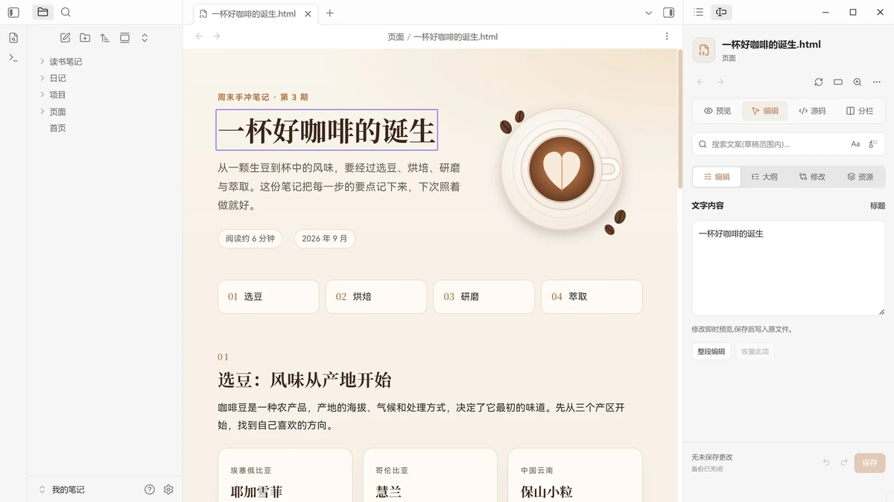
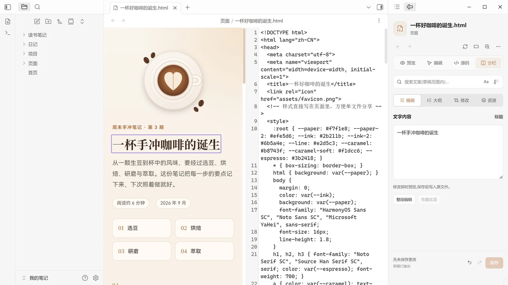
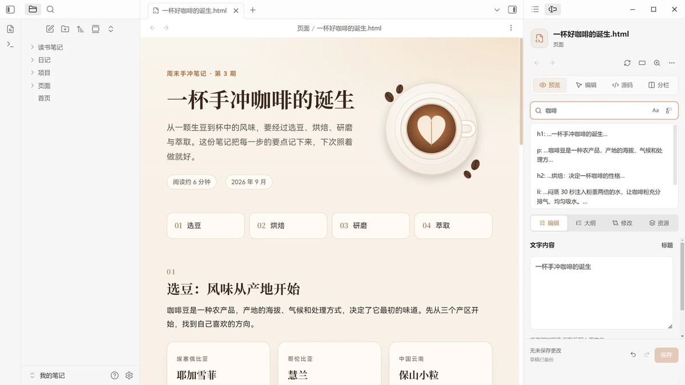
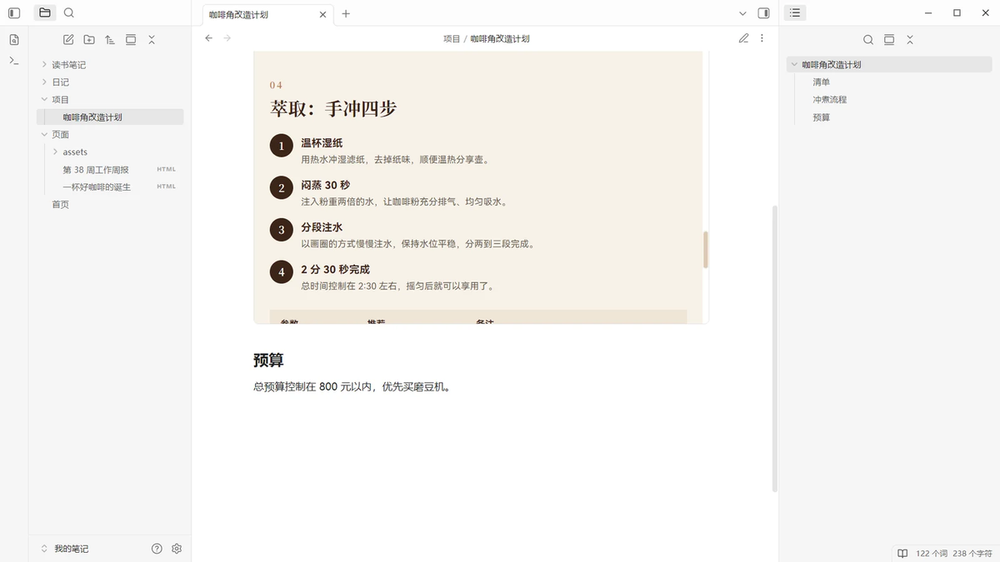
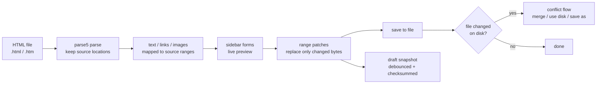

<p align="center">
  
</p>

<h1 align="center">HTML Atelier</h1>

<p align="center"><strong>Read and edit static <code>.html</code> files inside Obsidian.</strong><br>
Point at a heading, a link or an image on the page, edit it in the sidebar, and save only the source ranges you changed.</p>

<p align="center">
  <a href="https://github.com/384615666/obsidian-html-atelier/releases"></a>
  <a href="https://obsidian.md"></a>
  <a href="#installation"></a>
  <a href="LICENSE"></a>
  <a href="https://github.com/384615666/obsidian-html-atelier/releases"></a>
  <a href="https://htmlatelier.lsjx.xyz/"></a>
</p>

<p align="center">
  <a href="https://htmlatelier.lsjx.xyz/"><strong>Website</strong></a> ·
  <a href="https://community.obsidian.md/plugins/html-atelier">Community plugin</a> ·
  <a href="https://github.com/384615666/obsidian-html-atelier/releases">Releases</a> ·
  <a href="https://github.com/384615666/obsidian-html-atelier/issues">Issues</a> ·
  <a href="README.md">简体中文</a>
</p>

<p align="center">
  <a href="assets/readme/shot-edit.png"></a>
</p>

<p align="center"><sub>Edit mode: select a heading on the page, change its text in the sidebar, preview updates as you type, and saving writes it back to the file.</sub></p>

> **Obsidian Desktop 1.7.2+** · `.html` and `.htm` · UI in English or Chinese · MIT licensed · local files, no account or cloud service

## Why HTML Atelier

| Before | With HTML Atelier |
| --- | --- |
| The preview lives in a browser, the markup in an editor — switch back and forth for every small change | Open `.html` in the main workspace like any note, with page and source side by side |
| To fix one sentence you hunt through the source and risk touching neighbouring tags | Select the text, link or image on the page and edit it in the sidebar form |
| Saving reformats the whole document, so `git diff` is pure noise | Only the affected source ranges are rewritten; tags, attributes, comments, indentation, line endings and entity spellings stay untouched |
| Close the window without saving and the work is gone | Drafts are backed up automatically; conflicts with on-disk changes are detected before saving, with a three-way merge option |

HTML Atelier is intentionally not a general-purpose web page builder: it brings reading and content editing into Obsidian while keeping every rewrite confined to the matching source ranges.

## At a glance

<p align="center">
  
</p>

### Four modes and one workbench

| Area | Contents | Use it for |
| --- | --- | --- |
| Main view | **Preview / Edit / Source / Split** | Read the page, point-and-edit it, or edit raw HTML; Split shows source and preview side by side |
| Sidebar workbench | A persistent **search bar** above the tabs plus **Edit / Outline / Changes / Resources** tabs | Edit the selected object, jump between headings, find and replace, review unsaved changes, inspect referenced assets |
| Toolbar | Back/forward, mode switch, refresh, width, zoom, **More** menu | Navigate, adjust the viewport, copy links or embed code, open the draft manager or conflict resolution |

The toolbar lives at the top of the sidebar panel by default and can be moved into the view in **Settings → HTML Atelier → Editing → Toolbar location**; the save button sits in the workbench footer.

## What happens on every edit

<p align="center">
  
</p>

1. **Open** an `.html` or `.htm` file. The page is rendered in a sandboxed preview; page scripts do not run by default.
2. **Select** text, a link or an image; the sidebar switches to the matching form.
3. **Edit** with a live preview. Unsaved work is snapshotted into drafts on a debounce.
4. **Save**: edits are spliced back into the matching source ranges, leaving every other byte untouched, then written to disk.
5. If the file changed on disk while you were editing, a **conflict** is reported before saving: three-way merge, adopt the disk version, or save the draft as a separate file.

## Screenshots

<table>
  <tr>
    <td width="50%" align="center" valign="top">
      <a href="assets/readme/shot-edit.png"></a><br>
      <sub><b>Edit</b> · select a heading and change its text in the sidebar</sub>
    </td>
    <td width="50%" align="center" valign="top">
      <a href="assets/readme/shot-split.png"></a><br>
      <sub><b>Split</b> · source and preview side by side</sub>
    </td>
  </tr>
  <tr>
    <td width="50%" align="center" valign="top">
      <a href="assets/readme/shot-search.png"></a><br>
      <sub><b>Search</b> · find and replace within the current draft</sub>
    </td>
    <td width="50%" align="center" valign="top">
      <a href="assets/readme/shot-embed.png"></a><br>
      <sub><b>Embed</b> · an embedded page scrolled to an anchor in a note</sub>
    </td>
  </tr>
</table>

Screenshots are from HTML Atelier 2.1.0 (a demo vault, so individual settings such as draft backup may differ from defaults); click one to open the full-size image. The plugin interface is also available in English.

## Quick start

### Installation

| Requirement | Value |
| --- | --- |
| Obsidian | **Desktop 1.7.2 or later** |
| File types | `.html`, `.htm` |
| Mobile | Not supported (the plugin is marked desktop-only) |

**Option 1: Community plugins (recommended)**

1. Open **Settings → Community plugins** in Obsidian.
2. Browse community plugins, search for **HTML Atelier**, then install and enable it.
3. Open an `.html` or `.htm` file from your vault.

You can also visit the [community plugin page](https://community.obsidian.md/plugins/html-atelier), or open `obsidian://show-plugin?id=html-atelier` on a system with Obsidian installed.

**Option 2: Manual installation**

Download `main.js`, `manifest.json` and `styles.css` from the same release on [GitHub Releases](https://github.com/384615666/obsidian-html-atelier/releases) and place them directly in the plugin folder:

```text
.obsidian/plugins/html-atelier/
├── main.js
├── manifest.json
└── styles.css
```

Restart Obsidian, then enable **HTML Atelier** under **Settings → Community plugins**. Do not add an extra nested folder; if your vault uses a custom configuration folder, substitute it for `.obsidian`.

> If another enabled plugin already handles `.html` / `.htm`, disable it and restart to avoid file-registration conflicts.

### Your first edit

1. Open any `.html` file. The page appears in the main workspace and the sidebar workbench opens automatically by default.
2. Switch to **Edit** in the toolbar.
3. Select a heading, paragraph, link or image on the page and edit it under the **Edit** tab. The preview follows your typing.
4. Click **Save** to write the file. Unsaved work is backed up automatically and restored when you reopen the file, including after restarting Obsidian.

### Embed a page in a note

Add an `html-atelier` code block to any Markdown note:

````markdown
```html-atelier
path: "Pages/weekly-report.html"
height: auto
anchor: summary
```
````

| Parameter | Meaning |
| --- | --- |
| `path` | **Required**: path to an HTML file relative to the vault root. |
| `height` | `auto` or an integer from 160 to 1600; automatic height is capped by the embed settings. |
| `width` | `auto` or an integer from 240 to 3840, limited by the available note width. |
| `anchor` | Optional: scroll to the element's `id`, without a leading `#`. |
| `toolbar` | Set to `false` to hide the embed's open and refresh buttons. |

Embeds read the **saved file**, not the current unsaved draft; after saving, use the embed's refresh button to reload. You can also generate a code-block skeleton from **More → Copy HTML embed code** (it contains `path` and `toolbar` by default; add `height`, `width` or `anchor` as needed).

## Features

### Preview & navigation

- Preview static HTML in a sandboxed frame with page scripts disabled by default. Zoom is available in fixed steps (25%, 50%, 75%, 100%, 125%, 150%, 200%) plus reset to 100%; width offers Auto, Desktop 1440, Tablet 768, Mobile 390 and a custom value (240–3840 px).
- Local stylesheets referenced by `<link rel="stylesheet">` and CSS `@import` are inlined into the preview. Relative images and other assets resolve from the page's folder; references inside CSS resolve from the stylesheet's folder.
- Follow page anchors and links to other vault files. Back and forward navigation remembers each page's scroll position, and reading positions are remembered per file (the last 200 files by default, configurable).
- Referenced local CSS and images can refresh the preview automatically when they change. Remote images, styles, fonts and media are allowed by default and can be blocked in settings.
- Preview width and zoom are remembered per file.

### Visual editing

- **Text**: edit individual text segments, or switch to **paragraph editing** to work across inline formatting; paragraph mode supports `Enter` line breaks.
- **Links**: edit link text and target address, or choose an HTML file from the vault; right-click a broken link in the preview to relink it.
- **Images**: edit the image address and `alt`, choose a vault image, or import an external image; responsive `picture` / `srcset` structures are flagged and can be replaced with a single image.
- **Source mode**: edit raw HTML with line numbers, soft wrap and a configurable preview-refresh delay.
- Unaffected source ranges keep their original tags, attributes, comments, indentation, line endings and entity spellings; `<`, `>` and `&` typed into visual text fields are escaped as text.
- Undo and redo group consecutive typing, with a history limit of 200 transactions by default (configurable from 50 to 1000, bounded by a 32 MiB memory budget).

### Sidebar workbench

The workbench consists of a search bar above the tabs and four tabs:

- **Search bar**: find and replace in the current page draft, with case matching and Replace all. Whether hidden text is included is controlled in **Settings → HTML Atelier → Search → Search hidden text**. Matches spanning formatting boundaries are skipped and counted.
- **Edit**: forms for the selected text, link or image.
- **Outline**: heading navigation and a text list; click an entry to jump to its content.
- **Changes**: lists unsaved text changes, lets you locate them and restore supported text entries. Property-only or structural changes may appear as a source summary; use undo or source mode for those.
- **Resources**: lists referenced assets with local / missing / remote / blocked status and jumps to the source.
- The workbench footer shows the save button, save status, draft status, conflict status and missing-file warnings.

### Drafts & conflicts

- Draft backup is on by default: a snapshot is committed after roughly 750 ms of idle typing, with a maximum wait of about 3 seconds. Drafts are restored when the file is reopened, including after a restart. Backups are identified by device and stored under `.obsidian/plugins/html-atelier/drafts/`.
- A draft contains the original and edited HTML. If your sync tool includes the plugin folder, these backups may sync too. Save the drafts you need before removing the plugin folder.
- If the HTML file changes on disk while you have unsaved edits, a conflict is detected before saving. You can use a three-way **merge** (my draft / disk version / common base), adopt the disk version and drop the draft, or save the draft as a separate file.
- **Draft manager** (More → Draft manager…) lists backups, lets you search them, open the original, and discard selected drafts without deleting the HTML files. A warning appears when total draft storage exceeds the configured threshold.
- **Save as** writes a copy of the current draft, including unsaved edits; when saving to another folder you can rewrite local relative references. Asset files themselves are not copied.

### Links, anchors & sharing

- The toolbar **More** menu copies the page link or the HTML embed code, and can open the current file in your system browser. Copying a section link requires a selected anchor; otherwise the plugin tells you nothing was copied.
- Wiki links and Markdown links to HTML files open in the plugin's view; in-page anchors and vault links jump inside the preview.
- External links can open in the system browser or the in-app web viewer; `Ctrl/Cmd + click` and similar gestures open links directly in the browser.
- Embeds support height, width, anchor and toolbar visibility; the embed header shows the file name with refresh and open buttons by default.

### Interface & language

- The interface language follows Obsidian by default, and can be forced to Chinese or English in **Settings → HTML Atelier → General → Interface language**.
- Toolbar location, default mode, default text granularity, change highlights and focus restoration after saving are all configurable.
- Interface text, settings and status labels follow the language setting; command-palette entries, the text object-type label, embed buttons and error messages, and the default save-as filename suffix are still Chinese-only, as are the embed header's “draft” badge and the add/remove markers in the Changes panel.

## Safety model

HTML files can carry scripts. HTML Atelier only **shows** pages by default; it does not execute their code.

| Scenario | Page scripts | Network assets | Visual editing / position memory |
| --- | --- | --- | --- |
| **Default preview** (recommended) | Do not run: `<script>`, `on*` handler attributes and `http-equiv` metas are removed, and CSP blocks scripts, form submission and nested frames | Remote images / styles / fonts / media are allowed by default and can be disabled | Available |
| **Allow page scripts** (opt-in) | Run in an `allow-scripts` sandbox **without** `allow-same-origin` (opaque origin) | Governed by the "Allow network assets" setting | Unavailable: visual editing, reading-position memory, in-page link routing and embed auto-height are disabled |
| **Open in external browser** | Normal browser behaviour, including scripts | Not controlled by the plugin | Not applicable |

- "Allow page scripts" is off by default and should only be enabled for files you trust. When enabled, static local scripts, images, fonts, media, `srcset` and CSS `url()` references are embedded into the preview as data URLs (8 MiB per file, 4 MiB per script, 32 MiB per preview build); local resources created dynamically at runtime, cross-file module imports and unknown types are not embedded.
- Script mode is **isolated, not offline**: network assets are still allowed by default, so remote scripts and network requests from the page are also permitted. Consider disabling network assets as well when working with untrusted pages.
- In the default mode, form submissions are blocked and nested `iframe` / `object` / `embed` elements are removed. With scripts enabled, nested frames and form submissions remain blocked.
- Inlining local resources never reads `.obsidian`, `.git` or other configuration/credential directories.

## Scope & limits

- Visual editing covers **page text, link addresses and image attributes**. It is not a layout editor: use source mode for CSS, arbitrary HTML structure, form field values, and text inside SVG or other excluded elements.
- Segment editing follows the original text nodes. Paragraph editing keeps inline tags, but the distribution of changed text across formatting spans may change. Paragraphs that cannot be mapped to the source prompt you to use segment editing.
- Source mode edits HTML directly. Visual text fields escape special characters as text; segment line breaks follow HTML whitespace rules, while paragraph mode can insert `<br>`.
- Desktop Obsidian only; mobile is out of scope.
- Opening a page in an external browser uses that browser's normal behaviour for scripts and networking.

## FAQ

<details>
<summary><b>Will visual editing reformat my HTML?</b></summary>

No. The plugin replaces only the affected source ranges; untouched tags, attributes, comments, indentation, line endings and entity spellings stay byte-for-byte the same. Save-as can also keep relative references pointing at their original targets.
</details>

<details>
<summary><b>Do page scripts run?</b></summary>

Not by default. The preview removes scripts and inline handlers, blocks form submission, drops nested frames, and sets CSP `script-src` to `none`. If you need page scripts, enable **Allow page scripts** so they run in an isolated opaque-origin sandbox — visual editing, reading-position memory and several other features are unavailable in that mode, so only enable it for trusted files.
</details>

<details>
<summary><b>Can I edit CSS or page structure?</b></summary>

Visual editing does not cover layout or structure. Switch to **source mode** (or split mode) and edit the HTML or CSS directly; source edits still support undo, draft backup and saving.
</details>

<details>
<summary><b>What if another HTML plugin conflicts?</b></summary>

The plugin registers the `.html` / `.htm` extensions for its own view. If another plugin has taken them over, you are notified when the plugin is enabled: disable the old plugin and restart Obsidian; after the restart, `.html` / `.htm` files open in HTML Atelier again.
</details>

<details>
<summary><b>Where are drafts stored? Will uninstalling lose them?</b></summary>

By default under `.obsidian/plugins/html-atelier/drafts/`, named per device and containing the original and edited HTML. Uninstalling the plugin or deleting its folder also deletes these backups — reopen the original file to restore the draft, then use **Save as** to keep what you need.
</details>

<details>
<summary><b>What happens if the file changes outside Obsidian?</b></summary>

The plugin detects the change before saving and refuses to overwrite. You can three-way merge both sides, adopt the disk version, or save the current draft as a separate file. The same conflict flow applies when reopening or restoring a draft whose original file has changed.
</details>

<details>
<summary><b>Is mobile supported?</b></summary>

No. HTML Atelier relies on desktop Obsidian views, the code editor and local file access, and `manifest.json` marks it as desktop-only.
</details>

## How it works (for developers)



- **Parse & locate**: `parse5` parses HTML with source location info and maps text nodes to source ranges; paragraphs that cannot be aligned to the source prompt segment editing.
- **Surgical writes**: edits become range patches (`src/core/patch.ts`; paragraph-level planning lives in `src/parsing/paragraphEdit.ts`) that replace only the affected ranges; the file is never re-serialized as a whole.
- **Preview isolation**: the preview is a `srcdoc` document with a per-render nonce, isolated by a sandboxed iframe and CSP. Script mode switches to an opaque-origin sandbox and inlines static local assets as data URLs.
- **Drafts & conflicts**: draft records contain the base source, working copy, checksum and device ID, written via "temp file → verify → final file". When the content on disk differs from the last saved base, a conflict is reported and can be handled with a diff3-based three-way merge.
- **Embeds & links**: a Markdown code-block processor and a custom file view handle `html-atelier` blocks; link routing, anchor scrolling and reading positions go through the navigation service.

| Directory | Responsibility |
| --- | --- |
| `src/parsing` | HTML parsing, text mapping, segment / paragraph editing, URL handling |
| `src/core` | edit sessions, history, range patches, fingerprints and locators |
| `src/views` | main view, sidebar panel, toolbar, source editor, modals |
| `src/services` | preview asset inlining, saving, drafts, merging, links, navigation, sidebar coordination |
| `src/embed` | `html-atelier` block parsing and rendering |
| `src/settings` | settings schema, UI and default-value validation |
| `src/i18n` | Chinese / English strings |
| `tests` | `node:test` + jsdom unit tests and Playwright-based browser checks |

## Development

```sh
npm ci
npm run lint
npm run check
npm test
npm run build
node tests/browser-check.mjs
node tests/sidebar-regression.mjs
```

- The build produces `main.js` (with the bundled worker). Install it next to `manifest.json` and `styles.css`.
- Browser checks use Microsoft Edge by default (`C:/Program Files (x86)/Microsoft/Edge/Application/msedge.exe`); set `HTML_ATELIER_BROWSER` to another Chromium-based executable if needed.
- Tests cover parsing and patching, sessions and history, drafts, merging, settings validation and i18n key coverage; browser checks cover preview, interactions and sidebar regressions.

## License & credits

- Released under the [MIT License](LICENSE).
- Third-party licenses are listed in [THIRD-PARTY-NOTICES.txt](THIRD-PARTY-NOTICES.txt) (the core parsing dependency is `parse5`).
- The site lives in [`site/`](site/); the screenshots and diagrams used by this README live in [`assets/readme/`](assets/readme/).

<p align="center">
  <sub>HTML Atelier is a community plugin and is not affiliated with Obsidian. Obsidian is a trademark of Dynalist Inc.</sub><br>
  <sub>If this plugin helps you, consider starring it on <a href="https://github.com/384615666/obsidian-html-atelier">GitHub</a> or reporting issues in <a href="https://github.com/384615666/obsidian-html-atelier/issues">Issues</a>.</sub>
</p>
