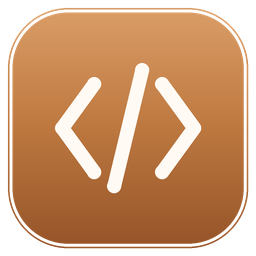
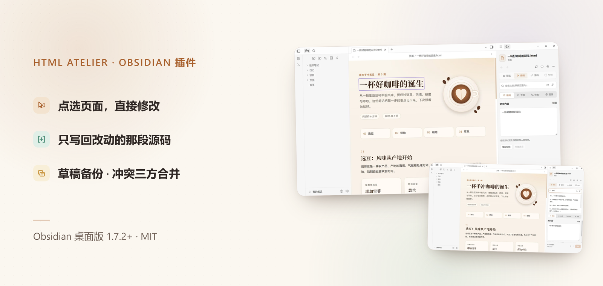
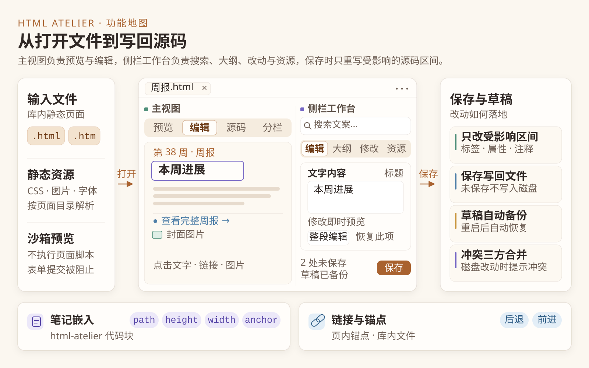
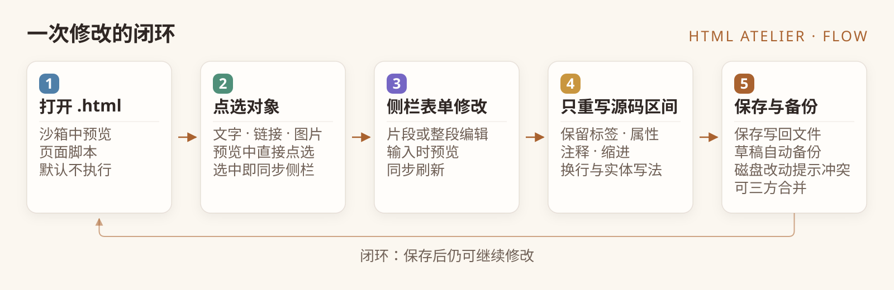
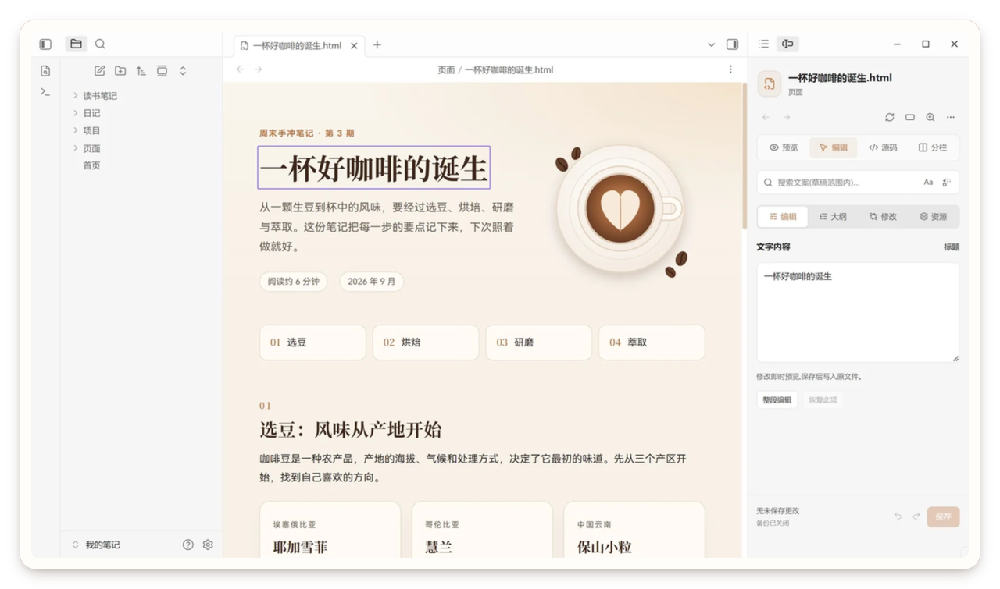
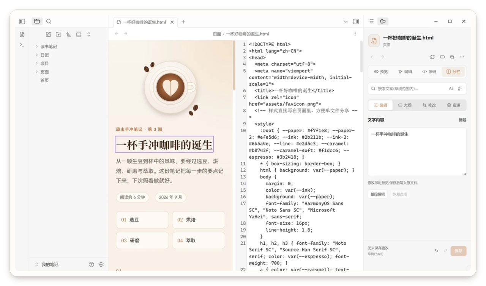
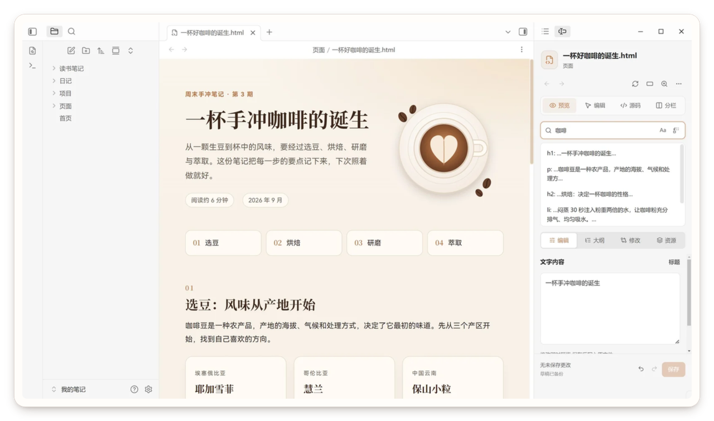
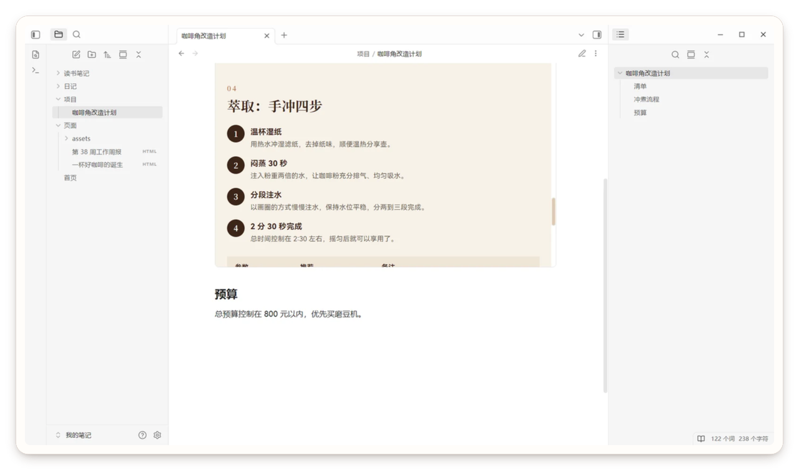

<p align="center">
  
</p>

<h1 align="center">HTML Atelier</h1>

<p align="center"><strong>在 Obsidian 里直接把 .html 当笔记来改。</strong><br>
点选页面上的文字、链接和图片直接编辑，保存修改。</p>

<p align="center">
  <a href="https://github.com/384615666/obsidian-html-atelier/releases"></a>
  <a href="https://obsidian.md"></a>
  <a href="#快速开始"></a>
  <a href="LICENSE"></a>
  <a href="https://github.com/384615666/obsidian-html-atelier/releases"></a>
  <a href="https://htmlatelier.lsjx.xyz/"></a>
</p>

<p align="center">
  <a href="https://htmlatelier.lsjx.xyz/"><strong>产品主页</strong></a> ·
  <a href="https://community.obsidian.md/plugins/html-atelier">社区插件页</a> ·
  <a href="https://github.com/384615666/obsidian-html-atelier/releases">发布版本</a> ·
  <a href="https://github.com/384615666/obsidian-html-atelier/issues">反馈问题</a> ·
  <a href="README.en.md">English</a>
</p>

<p align="center">
  <a href="assets/readme/hero-zh.png"></a>
</p>

<p align="center"><sub>支持 .html / .htm · 界面中英双语 · 本地文件，无需账号或云端服务</sub></p>

## 为什么是 HTML Atelier

-  **点选就改**：选中页面上的文字、链接或图片，在侧栏表单里修改，预览随输入更新。
-  **支持 JS，样式更加丰富**：页面可以使用完整 CSS 与可选页面脚本；脚本默认关闭，可在设置中开启，版式与交互比 Markdown 更自由。
-  **只改你动过的那一段**：未触及的标签、属性、注释、缩进、换行与实体写法保持原样，diff 里只有真正的改动。
-  **一个工作台覆盖全流程**：搜索、大纲、修改与资源都在侧栏；草稿自动备份，冲突时三方合并。

## 一眼看懂

<p align="center">
  
</p>

- **主视图**：预览 / 编辑 / 源码 / 分栏。
- **侧栏**：标签页上方常驻搜索栏 + 编辑 / 大纲 / 修改 / 资源四个标签。
- **保存**：只改你动过的那一段，其余内容原样保留。

## 一次修改，经历了什么

<p align="center">
  
</p>

1. **打开** `.html` / `.htm`，页面在沙箱预览中渲染；页面脚本默认不执行。
2. **点选**文字、链接或图片，侧栏切换到对应表单。
3. **修改**时预览实时更新，未保存内容自动备份成草稿。
4. **保存**：把改动拼回原始源码的对应区间，其余字符原样保留。
5. 若磁盘文件在你编辑期间被改动，保存前会提示**冲突**：三方合并、采用磁盘版本，或把草稿另存。

## 截图

<p align="center">
  <a href="assets/readme/shot-edit.png"></a>
  <a href="assets/readme/shot-split.png"></a>
  <br><sub><b>编辑</b> 选中标题，侧栏直接改文字 &nbsp;·&nbsp; <b>分栏</b> 源码与预览并排</sub>
</p>

<p align="center">
  <a href="assets/readme/shot-search.png"></a>
  <a href="assets/readme/shot-embed.png"></a>
  <br><sub><b>搜索</b> 在当前草稿中查找替换 &nbsp;·&nbsp; <b>嵌入</b> 笔记中的页面滚动到锚点</sub>
</p>

<p align="center"><sub>截图来自 HTML Atelier 2.1.0 的演示库，个别设置状态可能与默认值不同。</sub></p>

## 快速开始

需要 **Obsidian 桌面版 1.7.2 或更高版本**，支持 `.html`、`.htm`，不支持移动端。

1. **安装插件**：在 **设置 → 第三方插件 → 浏览** 中搜索 **HTML Atelier**，安装并启用。
2. **打开页面**：打开库里的 `.html` 或 `.htm` 文件，页面显示在主工作区，侧栏工作台默认自动展开。
3. **开始编辑**：切到 **编辑**，点选页面中的对象，在侧栏修改，然后点 **保存**。未保存的改动会自动备份。

<details>
<summary><b>手动安装 / 已有 HTML 插件冲突</b></summary>

从 [GitHub Releases](https://github.com/384615666/obsidian-html-atelier/releases) 下载同一版本的 `main.js`、`manifest.json`、`styles.css`，放进库的插件目录后重启 Obsidian：

```text
.obsidian/plugins/html-atelier/
├── main.js
├── manifest.json
└── styles.css
```

不要再套一层文件夹；使用自定义配置目录时把 `.obsidian` 换成实际目录。如果已有插件接管 `.html` / `.htm`，先停用旧插件并重启，重启后会自动由 HTML Atelier 打开。
</details>

<details>
<summary><b>在笔记里嵌入页面</b></summary>

在 Markdown 笔记中写入 `html-atelier` 代码块：

````markdown
```html-atelier
path: "Pages/weekly-report.html"
height: auto
anchor: summary
```
````

- `path`（必填）：相对于库根目录的 HTML 文件路径。
- `height`：`auto` 或 160–1600 的整数像素值；自动高度受嵌入设置上限约束。
- `width`：`auto` 或 240–3840 的整数像素值，不超过笔记可用宽度。
- `anchor`：可选，滚动到指定元素的 `id`，不需要写 `#`。
- `toolbar`：设为 `false` 隐藏嵌入的打开与刷新按钮。

嵌入读取**已保存文件**，不显示未保存草稿；保存后点刷新按钮重新载入。工具栏 **更多 → 复制 HTML 嵌入代码** 可生成代码块骨架。
</details>

## 功能

### 预览与导航

- 沙箱预览静态 HTML，页面脚本默认关闭；支持缩放档位（25%–200%）、常用宽度（自适应 / 1440 / 768 / 390 / 自定义）和按文件记忆视口。
- 库内样式表（`<link>`、`@import`）内联进预览，图片等相对资源按页面目录解析；远程资源默认允许，可在设置中关闭。
- 支持页内锚点、库内链接、后退 / 前进与阅读位置记忆；引用的本地 CSS、图片变化时可自动刷新。
- 预览滚动条默认仿 Obsidian 样式（细圆角、透明轨道），深色页面自动反白；页面自带滚动条样式时保持页面原样。

### 可视化编辑

- 编辑单个文字片段，或切换到**整段编辑**跨内联格式改字；链接可改文字、地址或选择库内文件；图片可改地址、`alt` 或导入外部图片。
- 未受影响的源码区间保留原有标签、属性、注释、缩进、换行与实体写法；特殊字符按文本转义。
- 源码模式支持行号、软换行与刷新延迟；撤销 / 重做会合并连续输入。

### 侧栏工作台

- **搜索栏**：在当前草稿内查找替换，支持区分大小写与全部替换；跨格式边界命中会跳过并提示。
- **编辑 / 大纲 / 修改 / 资源**：改选中对象、跳转标题与文案、定位并恢复文字改动、检查引用资源状态。
- 工作台底部显示保存按钮、保存 / 草稿 / 冲突状态与文件缺失提示。

### 草稿与冲突

- 草稿备份默认开启，按设备标识存放于 `.obsidian/plugins/html-atelier/drafts/`；重新打开文件（包括重启后）自动恢复。
- 磁盘内容与上次保存基准不一致时提示冲突：三方合并（我的草稿 / 磁盘版本 / 共同基准）、使用磁盘版本，或把草稿另存为独立文件。
- 更多 → 草稿管理… 可搜索、打开原文件或丢弃草稿；另存为支持重写本地相对引用，不复制资源文件。

### 链接、锚点与分享

- Wiki / Markdown 链接指向 HTML 文件时在插件视图内打开；页面内锚点与库内链接可在预览中直接跳转。
- 更多菜单可复制页面链接、HTML 嵌入代码，或在系统浏览器打开当前文件；复制章节链接需要先选中锚点。
- 嵌入支持高度、宽度、锚点与工具栏显隐，默认显示文件名与刷新 / 打开按钮。

<details>
<summary><b>默认值与限制</b></summary>

- 撤销历史：默认 200 个事务，可配 50–1000，受 32 MiB 内存预算约束。
- 草稿：连续输入约 750ms 提交快照，最长等待约 3 秒；容量提醒默认 50 MiB。
- 缩放：25% / 50% / 75% / 100% / 125% / 150% / 200% 七档；宽度 240–3840 px。
- 阅读位置记忆：默认最近 200 个文件，可配 20–2000。
- 脚本模式内联上限：单文件 8 MiB、单脚本 4 MiB、单次构建 32 MiB。
- 界面文案随语言切换；命令面板命令名、对象类型标签、嵌入按钮与错误提示、另存默认后缀仍固定中文。
</details>

## 安全模型

HTML 文件本身可以携带脚本。HTML Atelier 默认只**显示页面**，不执行页面里的代码。

| 场景 | 页面脚本 | 网络资源 | 可视化编辑 / 位置记忆 |
| --- | --- | --- | --- |
| **默认预览**（推荐） | 不执行：移除脚本、`on*` 事件与 `http-equiv` meta，CSP 禁止脚本、表单提交与嵌套框架 | 默认允许远程图片 / 样式 / 字体 / 媒体，可关闭 | 可用 |
| **允许页面脚本**（手动开启） | 在 `allow-scripts` 且**无** `allow-same-origin` 的不透明源沙箱中执行 | 受「允许加载网络资源」设置约束 | 不可用：可视化编辑、位置记忆、页内链接路由、嵌入自动高度关闭 |
| **外部浏览器打开** | 遵循浏览器正常行为，包括执行脚本 | 不受插件设置约束 | 不适用 |

- 「允许页面脚本」默认关闭，只应对可信文件开启；开启后静态本地资源会以 data URL 内联，运行时动态资源和跨文件模块导入不会。
- 脚本模式是「隔离」而不是「离线」：网络资源仍默认允许，远程脚本与请求也会被放行；处理不可信页面时建议同时关闭网络资源。

## 边界

- 可视化编辑面向**页面文字、链接地址与图片属性**，不编辑 CSS、任意 HTML 结构、表单字段值或 SVG 内文字；这些请用源码模式。
- 片段编辑遵循原文字节点；整段编辑保留内联标签，但改动文字在格式区间之间的分布可能变化。
- 仅支持桌面版 Obsidian；外部浏览器打开时，脚本与网络行为由浏览器决定。

## 常见问题

<details>
<summary><b>会把我原来的 HTML 重排吗？</b></summary>

不会。只替换受影响的源码区间，未触及的标签、属性、注释、缩进、换行与实体写法保持原样。另存为时也可以保持相对引用指向原目标。
</details>

<details>
<summary><b>页面里的 JavaScript 会执行吗？</b></summary>

默认不会。需要时可在设置中开启「允许页面脚本」，让脚本在隔离的不透明源沙箱中执行；此模式下可视化编辑、位置记忆等功能不可用，请只对可信文件开启。
</details>

<details>
<summary><b>能直接改 CSS 或页面结构吗？</b></summary>

可视化编辑不提供布局与结构编辑。切换到**源码模式**或分栏模式直接修改 HTML / CSS，源码编辑同样支持撤销、草稿备份与保存。
</details>

<details>
<summary><b>草稿存在哪里？卸载会丢吗？</b></summary>

默认在 `.obsidian/plugins/html-atelier/drafts/`，按设备标识命名，包含原始与编辑后的 HTML。卸载或删除插件目录会一并删除备份；请先重新打开原文件恢复草稿，再用「另存为」保留内容。
</details>

<details>
<summary><b>文件被其他程序改动了怎么办？</b></summary>

保存前会检测磁盘变化并阻止覆盖。你可以三方合并保留双方改动、采用磁盘版本，或把当前草稿另存为独立文件。
</details>

## 实现（给开发者）

- **解析与定位**：`parse5` 携带源码位置解析，建立文字节点到源码区间的映射；无法对齐时提示改用片段编辑。
- **局部改写**：编辑形成区间补丁（`src/core/patch.ts`，段落规划见 `src/parsing/paragraphEdit.ts`），保存时只替换受影响区间。
- **隔离预览**：`srcdoc` + nonce + 沙箱 iframe + CSP；脚本模式切换为不透明源沙箱并内联静态本地资源。
- **草稿与冲突**：草稿记录含原始源码、工作副本、校验和与设备标识，按「临时文件 → 校验 → 正式文件」写入，冲突时使用 diff3 三方合并。

<details>
<summary><b>目录结构</b></summary>

| 目录 | 职责 |
| --- | --- |
| `src/parsing` | HTML 解析、文字映射、片段 / 段落编辑、URL 处理 |
| `src/core` | 编辑会话、历史、区间补丁、指纹与定位 |
| `src/views` | 主视图、侧栏面板、工具栏、源码编辑器、弹窗 |
| `src/services` | 预览资源内联、保存、草稿、合并、链接、导航、侧栏协调 |
| `src/embed` | `html-atelier` 代码块解析与渲染 |
| `src/settings` | 设置 schema、界面与默认值校验 |
| `src/i18n` | 中文 / English 文案 |
| `tests` | `node:test` + jsdom 单元测试，以及基于 Playwright 的浏览器检查 |
</details>

## 开发

```sh
npm ci
npm run lint
npm run check
npm test
npm run build
node tests/browser-check.mjs
node tests/sidebar-regression.mjs
```

- 构建产物为 `main.js`（含打包后的 Worker），与 `manifest.json`、`styles.css` 一起安装。
- 浏览器检查默认使用 Microsoft Edge；可用 `HTML_ATELIER_BROWSER` 指定其他 Chromium 浏览器。

## 许可证

- 本项目以 [MIT 许可证](LICENSE) 发布；第三方依赖许可见 [THIRD-PARTY-NOTICES.txt](THIRD-PARTY-NOTICES.txt)。
- 站点位于 [`site/`](site/)；README 使用的截图与图解位于 [`assets/readme/`](assets/readme/)。

<p align="center">
  <sub>HTML Atelier 是社区插件，与 Obsidian 官方无隶属关系。Obsidian 是 Dynalist Inc. 的商标。</sub><br><br>
  <a href="https://github.com/384615666/obsidian-html-atelier/releases"></a>
  <a href="https://github.com/384615666/obsidian-html-atelier"></a>
</p>
