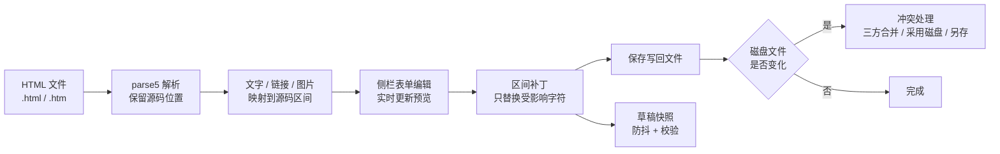

<p align="center">
  
</p>

<h1 align="center">HTML Atelier</h1>

<p align="center"><strong>在 Obsidian 里，把 .html 当成页面来读、来改。</strong><br>
点选页面上的文字、链接和图片直接编辑，保存时只重写改过的那段源码，其余原样保留。</p>

<p align="center">
  <a href="https://github.com/384615666/obsidian-html-atelier/releases"></a>
  <a href="https://obsidian.md"></a>
  <a href="#安装"></a>
  <a href="LICENSE"></a>
  <a href="https://github.com/384615666/obsidian-html-atelier/releases"></a>
  <a href="https://htmlatelier.lsjx.xyz/"></a>
</p>

<p align="center">
  <a href="https://htmlatelier.lsjx.xyz/"><strong>产品主页</strong></a> ·
  <a href="https://community.obsidian.md/plugins/html-atelier">社区插件页</a> ·
  <a href="https://github.com/384615666/obsidian-html-atelier/releases">发布版本</a> ·
  <a href="https://github.com/384615666/obsidian-html-atelier/issues">反馈问题</a> ·
  <a href="README.en.md">English</a>
</p>

<p align="center">
  <a href="assets/readme/shot-edit.png"></a>
</p>

<p align="center"><sub>编辑模式：点选页面里的标题，在右侧栏改文字，预览随输入更新，保存后写回原文件。</sub></p>

> **Obsidian 桌面版 1.7.2+** · 支持 `.html` / `.htm` · 界面跟随 Obsidian 语言，可切换中文 / English · MIT 开源 · 本地文件，无需账号或云端服务

## 为什么是 HTML Atelier

| 以前 | 现在 |
| --- | --- |
| 预览在浏览器，标签在编辑器，改一个词要来回切换 | `.html` 和普通笔记一样在主工作区打开，页面与源码同屏 |
| 改一句话要翻源码、数行号、担心碰坏相邻标签 | 点选页面上的文字、链接或图片，在侧栏表单里改 |
| 保存时整份格式化，`git diff` 全是噪音 | 只更新受影响的源码区间，标签、属性、注释、缩进、换行和实体写法保持不变 |
| 切走窗口忘了保存，内容就没了 | 草稿自动备份；磁盘文件被改动时先提示冲突，可三方合并 |

HTML Atelier 不是通用网页编辑器：它把「读页面」和「改内容」放进 Obsidian，同时把改写的范围严格限制在源码的对应区间里。

## 一张图看懂

<p align="center">
  
</p>

### 四种模式与一个工作台

| 位置 | 组成 | 适合做什么 |
| --- | --- | --- |
| 主视图 | **预览 / 编辑 / 源码 / 分栏** | 阅读页面、点选编辑，或直接改 HTML；分栏模式源码与预览并排 |
| 侧栏工作台 | 标签页上方的**搜索栏** + **编辑 / 大纲 / 修改 / 资源**四个标签 | 改选中对象、跳转标题、查找替换、核对未保存改动、检查引用资源 |
| 工具栏 | 后退、前进、模式切换、刷新、宽度、缩放、**更多**菜单 | 导航、调视口、复制链接与嵌入代码、打开草稿管理或冲突处理 |

工具栏默认在侧栏面板顶部，也可以在 **设置 → HTML Atelier → 编辑 → 工具栏位置** 中移回主视图；保存按钮位于工作台底部的状态区。

## 一次修改，经历了什么

<p align="center">
  
</p>

1. **打开** `.html` / `.htm`，插件用沙箱预览渲染页面；页面脚本默认不执行。
2. **点选**页面上的文字、链接或图片，侧栏「编辑」标签切换到对应表单。
3. **修改**时预览实时更新；未保存内容按防抖节奏备份成草稿。
4. **保存**：把改动拼回原始源码的对应区间，其余字符原样保留，再写入磁盘。
5. 若磁盘上的文件在你编辑期间被其他程序改过，保存前会提示**冲突**：三方合并、采用磁盘版本，或把草稿另存为独立文件。

## 截图

<table>
  <tr>
    <td width="50%" align="center" valign="top">
      <a href="assets/readme/shot-edit.png"></a><br>
      <sub><b>编辑</b> · 选中标题，侧栏直接改文字</sub>
    </td>
    <td width="50%" align="center" valign="top">
      <a href="assets/readme/shot-split.png"></a><br>
      <sub><b>分栏</b> · 源码与预览并排，改哪看哪</sub>
    </td>
  </tr>
  <tr>
    <td width="50%" align="center" valign="top">
      <a href="assets/readme/shot-search.png"></a><br>
      <sub><b>搜索</b> · 在当前草稿中查找与替换</sub>
    </td>
    <td width="50%" align="center" valign="top">
      <a href="assets/readme/shot-embed.png"></a><br>
      <sub><b>嵌入</b> · 笔记中的页面滚动到指定锚点</sub>
    </td>
  </tr>
</table>

截图来自 HTML Atelier 2.1.0 的实际界面（演示库），个别设置状态（例如草稿备份）可能与默认值不同；点击图片可查看原图。

## 快速开始

### 安装

| 项目 | 要求 |
| --- | --- |
| Obsidian | **桌面版 1.7.2 或更高版本** |
| 文件类型 | `.html`、`.htm` |
| 移动端 | 不支持（插件标记为仅桌面可用） |

**方式一：社区插件市场（推荐）**

1. 在 Obsidian 中打开 **设置 → 第三方插件 → 浏览**。
2. 搜索 **HTML Atelier**，安装并启用。
3. 打开库里的 `.html` 或 `.htm` 文件即可开始。

也可以在浏览器打开 [社区插件页](https://community.obsidian.md/plugins/html-atelier)，或在已安装 Obsidian 的系统中打开 `obsidian://show-plugin?id=html-atelier`。

**方式二：手动安装**

从 [GitHub Releases](https://github.com/384615666/obsidian-html-atelier/releases) 下载同一版本的 `main.js`、`manifest.json` 和 `styles.css`，直接放进库的插件目录：

```text
.obsidian/plugins/html-atelier/
├── main.js
├── manifest.json
└── styles.css
```

重启 Obsidian，然后在 **设置 → 第三方插件** 中启用 **HTML Atelier**。不要再套一层文件夹；如果库使用了自定义配置目录，请把 `.obsidian` 换成实际目录。

> 如果已有其他插件接管 `.html` / `.htm`，请先停用并重启，避免文件类型注册冲突。

### 第一次编辑

1. 打开任意 `.html` 文件，主工作区显示页面，侧栏工作台默认自动展开。
2. 在工具栏切换到 **编辑**。
3. 点选页面中的标题、段落、链接或图片，在侧栏「编辑」标签里修改；输入时预览同步变化。
4. 点 **保存** 写回原文件。未保存的改动会自动备份，重新打开文件（包括重启 Obsidian 后）可恢复。

### 在笔记里嵌入页面

在 Markdown 笔记中写入 `html-atelier` 代码块：

````markdown
```html-atelier
path: "Pages/weekly-report.html"
height: auto
anchor: summary
```
````

| 参数 | 含义 |
| --- | --- |
| `path` | **必填**，相对于库根目录的 HTML 文件路径。 |
| `height` | `auto` 或 160–1600 的整数像素值；自动高度受嵌入设置上限约束。 |
| `width` | `auto` 或 240–3840 的整数像素值，不超过笔记可用宽度。 |
| `anchor` | 可选，滚动到指定元素的 `id`，不需要写 `#`。 |
| `toolbar` | 设为 `false` 隐藏嵌入的打开与刷新按钮。 |

嵌入读取的是**已保存文件**，不显示当前未保存草稿；保存后点嵌入的刷新按钮重新载入。也可以在 **更多 → 复制 HTML 嵌入代码** 中生成代码块骨架（默认只含 `path` 与 `toolbar`，可自行补 `height` / `width` / `anchor`）。

## 功能详情

### 预览与导航

- 在沙箱框架中预览静态 HTML，页面脚本默认关闭；缩放提供 25% / 50% / 75% / 100% / 125% / 150% / 200% 七档与「恢复 100%」，宽度提供自适应、桌面 1440、平板 768、手机 390 与自定义（240–3840 像素）。
- 通过 `<link rel="stylesheet">` 与 CSS `@import` 引用的库内样式会内联进预览；图片等相对资源按页面目录解析，CSS 内的相对资源按样式表目录解析。
- 支持页内锚点和库内文件链接；后退 / 前进默认记住每页的滚动位置，阅读位置按文件记忆（默认最近 200 个文件，可配置）。
- 引用的本地 CSS、图片变化时可自动刷新预览；远程图片、样式、字体和媒体默认允许加载，可在设置中统一关闭。
- 预览与编辑视口（宽度、缩放）可以按文件记忆。

### 可视化编辑

- **文字**：编辑单个文字片段，或切换到**整段编辑**跨内联格式修改文字；整段模式支持 `Enter` 换行。
- **链接**：修改链接文字与目标地址，或从库内选择 HTML 文件；预览中右键点击失效链接可选择「重新链接…」。
- **图片**：修改图片地址与 `alt`，从库内选择图片，或把外部图片导入库中；响应式 `picture` / `srcset` 结构会提示，可替换为单一图片。
- **源码模式**：直接编辑 HTML，支持行号、软换行，以及源码刷新延迟配置。
- 未受影响的源码区间保留原有标签、属性、注释、缩进、换行格式和实体写法；可视化输入中的 `<`、`>`、`&` 会按文本转义。
- 撤销 / 重做会合并连续输入，历史上限默认 200 个事务，可在 50–1000 之间调整（同时受 32 MiB 内存预算约束）。

### 侧栏工作台

工作台由标签页上方的搜索栏和四个标签页组成：

- **搜索栏**：在当前页面草稿内查找与替换，支持区分大小写与「全部替换」；是否包含隐藏文字由 **设置 → HTML Atelier → 搜索 → 搜索包含隐藏文字** 决定。跨格式边界的匹配会被跳过并提示数量。
- **编辑**：按当前选中的文字、链接或图片显示对应表单。
- **大纲**：浏览标题大纲与文案列表，点击条目可跳转到对应内容。
- **修改**：列出未保存的文字改动，可定位并恢复支持还原的文字条目；纯属性或结构改动可能以源码摘要显示，需改用撤销或源码模式处理。
- **资源**：列出页面引用的资源，标注本地可用、缺失、远程或已按设置拦截，并可跳转到对应源码。
- 工作台底部显示保存按钮、保存状态、草稿状态、冲突状态与文件缺失提示。

### 草稿与冲突

- 草稿备份默认开启：连续输入约 750ms 后提交一次快照，最迟约 3 秒落盘；重新打开文件时自动恢复（包括重启 Obsidian 后）。备份按设备标识命名，存放在 `.obsidian/plugins/html-atelier/drafts/`。
- 草稿包含原始源码与编辑后的内容；如果同步工具包含插件目录，这些备份也可能被同步。删除插件目录前请先保存需要保留的草稿。
- 当磁盘上的 HTML 在你编辑期间发生变化，插件会在保存前检测冲突，并提供三种处理：**三方合并**（我的草稿 / 磁盘版本 / 共同基准）、**使用磁盘版本（放弃草稿）**、或把草稿**另存为**独立文件。
- **草稿管理**（更多 → 草稿管理…）可以搜索草稿、打开原文件、丢弃选中的草稿；丢弃草稿不会删除原始 HTML。草稿总量超过提醒阈值时会在管理器中提示。
- **另存为**会保存当前草稿的副本（包含未保存修改）；跨目录另存时可选择重写本地相对引用，资源文件本身不会被复制。

### 链接、锚点与分享

- 在工具栏 **更多** 菜单中可复制页面链接、HTML 嵌入代码，也可以在系统浏览器中打开当前文件；复制当前章节链接需要页面上已选中锚点，否则会提示没有可复制的锚点。
- Wiki 链接与 Markdown 链接指向 HTML 文件时，会在插件视图内打开；页面内的锚点与库内链接可在预览中直接跳转。
- 页面内的外部链接可配置为系统浏览器或应用内网页查看器；`Ctrl/Cmd + 点击` 等手势可直接在浏览器打开。
- 在笔记中嵌入的页面可设置高度、宽度、锚点与工具栏显隐；嵌入默认显示文件名与刷新 / 打开按钮。

### 界面与语言

- 界面语言默认跟随 Obsidian，也可以在 **设置 → HTML Atelier → 通用 → 界面语言** 中强制中文或 English。
- 工具栏位置、默认打开模式、默认文字编辑粒度、修改高亮、保存后焦点恢复等都可以在设置中调整。
- 界面文案、设置项与状态会随语言切换；命令面板命令名、文字对象类型标签、嵌入按钮与错误提示、另存为的默认文件名后缀目前仍固定为中文，嵌入标题栏的「草稿」标记与「修改」面板的增删标记同样如此。

## 安全模型

HTML 文件本身可以携带脚本。HTML Atelier 默认只让你**看页面**，不执行页面里的代码。

| 场景 | 页面脚本 | 网络资源 | 可视化编辑 / 位置记忆 |
| --- | --- | --- | --- |
| **默认预览**（推荐） | 不执行：移除 `<script>`、`on*` 事件属性与 `http-equiv` meta，CSP 禁止脚本、表单提交和嵌套框架 | 默认允许远程图片 / 样式 / 字体 / 媒体，可在设置中关闭 | 可用 |
| **允许页面脚本**（手动开启） | 在 `allow-scripts` 但**无** `allow-same-origin` 的不透明源沙箱中执行 | 受「允许加载网络资源」设置约束 | 不可用：可视化编辑、阅读位置记忆、页内链接路由、嵌入自动高度都会关闭 |
| **外部浏览器打开** | 遵循浏览器正常行为，包括执行脚本 | 不受插件设置约束 | 不适用 |

- 「允许页面脚本」默认关闭，只应对可信文件开启。开启后，页面静态引用的本地脚本、图片、字体、媒体、`srcset` 与 CSS `url()` 会以 data URL 形式内联进预览（单文件 8 MiB、单脚本 4 MiB、单次构建总量 32 MiB）；运行时动态创建的本地资源、跨文件模块导入和未知类型不会被内联。
- 脚本模式是「隔离」而不是「离线」：网络资源开关仍默认允许，因此页面里的远程脚本与网络请求也会被放行；只处理可信页面时，建议同时关闭网络资源。
- 默认模式下表单提交被拦截，嵌套的 `iframe` / `object` / `embed` 会被移除；开启脚本后，嵌套框架和表单提交仍会被拦截。
- 内联本地资源时不会读取 `.obsidian`、`.git` 等配置/凭据目录中的文件。

## 编辑范围与边界

- 可视化编辑面向**页面文字、链接地址与图片属性**，不是通用布局编辑器。CSS、任意 HTML 结构、表单字段值，以及 SVG 或其他排除元素内的文字，请使用源码模式。
- 片段编辑遵循原有文字节点；整段编辑会保留内联标签，但修改后的文字在各格式区间之间的分布可能变化。无法映射到源码的段落请改用片段编辑。
- 源码模式直接编辑 HTML；可视化文字表单中的特殊字符会转义为文本；片段换行遵循 HTML 空白规则，整段模式可插入 `<br>`。
- 仅支持桌面版 Obsidian；移动端不在支持范围内。
- 外部浏览器打开页面时，脚本与网络行为由浏览器决定，插件不做拦截。

## 常见问题

<details>
<summary><b>可视化编辑会把我原来的 HTML 重排吗？</b></summary>

不会。插件只替换受影响的源码区间，未触及的标签、属性、注释、缩进、换行格式和实体写法都保持原样。另存为时也可以选择保持相对引用指向原目标。
</details>

<details>
<summary><b>页面里的 JavaScript 会执行吗？</b></summary>

默认不会。预览会移除脚本与内联事件、禁止表单提交并拦截嵌套框架，CSP 也将 `script-src` 设为 `none`。需要运行页面脚本时，可在设置中开启「允许页面脚本」，让脚本在隔离的不透明源沙箱中执行；此模式下可视化编辑、阅读位置记忆等功能不可用，请只对可信文件开启。
</details>

<details>
<summary><b>能直接改 CSS 或页面结构吗？</b></summary>

可视化编辑不提供布局与结构编辑。请切换到**源码模式**（或分栏模式）直接修改 HTML / CSS，源码编辑同样支持撤销、草稿备份与保存。
</details>

<details>
<summary><b>和别的 HTML 插件冲突怎么办？</b></summary>

插件通过注册 `.html` / `.htm` 扩展名接管文件视图。如果已有插件占用，启用时会提示已被接管：先停用旧插件并重启 Obsidian，重启后 `.html` / `.htm` 会自动由 HTML Atelier 打开。
</details>

<details>
<summary><b>草稿存在哪里？卸载插件会丢吗？</b></summary>

默认在库的 `.obsidian/plugins/html-atelier/drafts/` 下，按设备标识命名，包含原始与编辑后的 HTML。卸载或删除插件目录会一并删除这些备份，请先重新打开原文件恢复草稿，再用「另存为」保留需要的内容。
</details>

<details>
<summary><b>文件被其他程序改动了怎么办？</b></summary>

插件会在保存前检测磁盘变化并阻止覆盖。你可以使用三方合并保留双方改动、采用磁盘版本，或把当前草稿另存为独立文件。打开或恢复草稿时遇到文件已变化，也会进入冲突处理流程。
</details>

<details>
<summary><b>支持移动端吗？</b></summary>

不支持。HTML Atelier 依赖桌面版 Obsidian 的视图、代码编辑器与本地文件能力，`manifest.json` 标记为仅桌面可用。
</details>

## 实现原理（给开发者）



- **解析与定位**：`parse5` 携带源码位置解析 HTML，建立文字节点到源码区间的映射；段落无法对齐到源码时，会提示改用片段编辑。
- **局部改写**：编辑结果先形成区间补丁（`src/core/patch.ts`；段落级规划见 `src/parsing/paragraphEdit.ts`），保存时按区间替换，不做整份序列化。
- **预览隔离**：预览以 `srcdoc` 生成带 nonce 的文档，配合沙箱 iframe 与 CSP 隔离页面；脚本模式切换为不透明源沙箱，并把静态本地资源内联为 data URL。
- **草稿与冲突**：草稿记录包含原始源码、工作副本、校验和与设备标识，写入采用「临时文件 → 校验 → 正式文件」；磁盘内容与上次保存的基准不一致时会触发冲突，处理时可使用三方合并（diff3）。
- **嵌入与链接**：注册 `html-atelier` Markdown 代码块处理器与自定义文件视图；链接路由、锚点滚动和阅读位置由导航服务统一处理。

| 目录 | 职责 |
| --- | --- |
| `src/parsing` | HTML 解析、文字映射、片段 / 段落编辑、URL 处理 |
| `src/core` | 编辑会话、历史、区间补丁、指纹与定位 |
| `src/views` | 主视图、侧栏面板、工具栏、源码编辑器、弹窗 |
| `src/services` | 预览资源内联、保存、草稿、合并、链接、导航、侧栏协调 |
| `src/embed` | `html-atelier` 代码块解析与渲染 |
| `src/settings` | 设置 schema、界面与默认值校验 |
| `src/i18n` | 中文 / English 文案 |
| `tests` | `node:test` + jsdom 单元测试，以及基于 Playwright 的浏览器检查 |

## 开发与构建

```sh
npm ci
npm run lint
npm run check
npm test
npm run build
node tests/browser-check.mjs
node tests/sidebar-regression.mjs
```

- 构建产物为 `main.js`（已包含打包后的 Worker）；安装时与 `manifest.json`、`styles.css` 放在同一目录。
- 浏览器检查默认使用 Microsoft Edge（`C:/Program Files (x86)/Microsoft/Edge/Application/msedge.exe`）；可用 `HTML_ATELIER_BROWSER` 指定其他 Chromium 内核浏览器的可执行文件。
- 自动化测试覆盖解析与补丁、会话与历史、草稿、合并、设置校验、i18n 键集合等；浏览器检查覆盖预览、交互与侧栏回归。

## 许可证与致谢

- 本项目以 [MIT 许可证](LICENSE) 发布。
- 第三方依赖许可见 [THIRD-PARTY-NOTICES.txt](THIRD-PARTY-NOTICES.txt)（核心解析依赖 `parse5`）。
- 站点位于 [`site/`](site/)；README 使用的截图与图解位于 [`assets/readme/`](assets/readme/)。

<p align="center">
  <sub>HTML Atelier 是社区插件，与 Obsidian 官方无隶属关系。Obsidian 是 Dynalist Inc. 的商标。</sub><br>
  <sub>如果这个插件帮到了你，欢迎到 <a href="https://github.com/384615666/obsidian-html-atelier">GitHub</a> 点个 Star，或在 <a href="https://github.com/384615666/obsidian-html-atelier/issues">Issues</a> 反馈问题。</sub>
</p>
